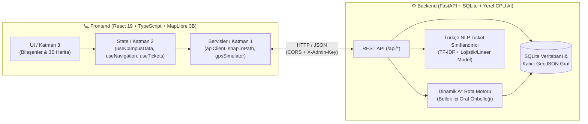

# 🧭 GTÜ-NAV: Gebze Teknik Üniversitesi Akıllı Kampüs Navigasyon ve Arıza Bildirim Sistemi

> **Bilişim Vadisi HackInovasyon 2026** | Kategori: **Akıllı Kampüs & Konum Tabanlı Deneyim Sistemleri**

**GTÜ-NAV**, yaklaşık **1.400.000 m²** (360 hektar) büyüklüğündeki ormanlık ve çok binalı Gebze Teknik Üniversitesi (Çayırova) kampüsünde; öğrencilerin, akademisyenlerin ve ziyaretçilerin yaya navigasyonu, engelsiz rota bulma, derslik/akademisyen arama, Marmaray ring takibi ve anlık kampüs arıza bildirim süreçlerini tek bir hızlandırılmış 3B web arayüzünde birleştiren yeni nesil bir **Akıllı Kampüs Platformudur**.

---

## 🎯 Problem ve Çözüm Yaklaşımımız

| Kampüsteki Gerçek Problem | GTÜ-NAV Mühendislik Çözümü |
| :--- | :--- |
| **Standart Harita Uygulamalarının Kampüs İçi Yetersizliği:** Ticari harita servisleri kampüs içindeki patikaları, kilitli kapıları, dik merdivenleri ve bina içi derslik/akademisyen bilgilerini bilmez. | **Kampüse Özel Yaya Grafı ve Dinamik A\* (A-Star) Rota Motoru:** Kampüs içi tüm yürüyüş yollarını, bina giriş kapılarını, eğim/merdiven bilgilerini ve anlık kapalı yolları bilen özel topolojik graf motoru. |
| **GPS Sıçramaları (Ağaçlık & Bina Kanyonu Etkisi):** Ham mobil GPS verisi kampüs binaları ve sık ağaçlık alanlarda 5–15 metre saparak kullanıcıyı bina duvarlarının içinden yürüyormuş gibi gösterir. | **2B Kalman Filtresi + Vektörel `Snap-to-Path` Motoru:** Ham GPS gürültüsünü filtreleyip yaya konumunu en yakın fiziksel yürüyüş koridoruna dik izdüşümle kilitleyen kesintisiz konum sabitleme algoritması. |
| **Engelsiz Kampüs Erişimi Eksikliği:** Tekerlekli sandalye kullanan veya hareket kısıtlılığı olan bireyler için merdivensiz rota bulmak imkânsızdır. | **♿ Engelsiz Rota Modu:** Merdivenli ve dik eğimli kenarları graf üzerinde otomatik eleyerek yalnızca düzayak ve rampalı yollardan alternatif rota üreten erişilebilirlik motoru. |
| **Kayıtsız ve Sınıflandırılmayan Kampüs Arızaları:** Kırık kaldırımlar, aydınlatma sorunları veya su kaçakları ilgili daire başkanlığına ulaşmadan kaybolur. | **🧠 Yerel Yapay Zekâ Destekli Yazılı Ticket & LiveOps Merkezi:** KVKK uyumlu (fotoğrafsız, yalnızca yazılı) arıza bildirimlerini **<5 ms** içinde ilgili birime ve aciliyet puanına göre sınıflandıran Türkçe NLP modeli. |

---

## 🏗️ Sistem Mimarisi ve Klasör Yapısı

GTÜ-NAV, yarışma şartnamesine tam uyumlu olarak **tek komutla (`docker compose up --build`)** ayağa kalkan, dış bulut API anahtarı gerektirmeyen (Offline-Ready) iki katmanlı bir mikro-mimari üzerine inşa edilmiştir:



### 📂 Depo (Repository) Dizin Yapısı

```text
GTÜ-NAV/
├── docker-compose.yml              # Tek komutla tam yığın (Full-Stack) orkestrasyon
├── .env.example                    # Örnek ortam değişkenleri şablonu
├── backend/                        # Python 3.12 + FastAPI Arka Uç Servisi (Port: 8000)
│   ├── Dockerfile
│   ├── requirements.txt
│   ├── app/
│   │   ├── main.py                 # REST API uç noktaları, sağlık kontrolü ve güvenlik
│   │   ├── models.py & schemas.py  # SQLAlchemy ORM modelleri ve Pydantic şemaları
│   │   ├── seed.py                 # Kampüs binaları, derslikler ve yürüyüş ağı tohumlayıcı
│   │   ├── routing/
│   │   │   └── astar.py            # Bellek önbellekli (RAM-cached) Dinamik A* & Engelsiz Rota
│   │   └── ai/
│   │       ├── dataset.py          # Kampüs odaklı Türkçe arıza/bildirim eğitim veri seti
│   │       ├── train_model.py      # TF-IDF (Kelime + Karakter N-Gram) model eğitici
│   │       └── ticket_classifier.py# <5ms CPU çıkarım (Inference) motoru
│   ├── data/
│   │   ├── campus_buildings.json   # 3B bina poligonları, akademisyenler ve ders programları
│   │   └── campus_walkways.geojson # Topolojik yürüyüş yolları ve düğüm (Node/Edge) ağı
│   └── tests/                      # Pytest birim ve entegrasyon test paketi (13/13 PASS)
└── frontend/                       # React 19 + TypeScript + Vite + Tailwind v4 (Port: 3000)
    ├── Dockerfile
    ├── src/
    │   ├── services/               # Katman 1: Saf iş mantığı (snapToPath, gpsSimulator, apiClient)
    │   ├── hooks/                  # Katman 2: React durum kancaları (useNavigation, useTickets, useAuth)
    │   └── components/             # Katman 3: 3B Harita, LiveOps Paneli, Bina Detay Çekmecesi
    └── public/
```

---

## 🚀 Hızlı Kurulum ve Çalıştırma (Tek Komut)

Projeyi çalıştırmak için sisteminizde **Docker** ve **Docker Compose** kurulu olması yeterlidir. Herhangi bir dış API anahtarına (Google Maps, OpenAI vb.) ihtiyaç **duyulmaz**.

### 1. Docker ile Tek Komutta Başlatma (Önerilen)

```bash
git clone <repo-url>
cd GTÜ-NAV
docker compose up --build
```

Konteynerler ayağa kalktığında tarayıcınızdan aşağıdaki adreslere erişebilirsiniz:

| Servis | Adres (URL) | Açıklama |
| :--- | :--- | :--- |
| **🌐 Web Uygulaması (Frontend)** | [http://localhost:3000](http://localhost:3000) | 3B Kampüs Haritası, Yaya Navigasyonu & Yönetici LiveOps Paneli |
| **📘 Swagger API Dokümantasyonu** | [http://localhost:8000/docs](http://localhost:8000/docs) | İnteraktif OpenAPI / REST uç nokta dokümantasyonu |
| **🩺 Sistem Sağlık Kontrolü** | [http://localhost:8000/health](http://localhost:8000/health) | Veritabanı, AI Modeli ve Graf Motoru canlılık durumu (`200 OK`) |

---

### 2. Yerel Geliştirme Ortamında (Docker Olmadan) Çalıştırma

**Arka Uç (Backend - Port 8000):**
```bash
python -m venv .venv
# Windows:
.\.venv\Scripts\activate
# Linux / macOS:
source .venv/bin/activate

pip install -r backend/requirements.txt
uvicorn app.main:app --app-dir backend --reload --port 8000
```

**Ön Yüz (Frontend - Port 3000):**
```bash
cd frontend
npm install
npm run dev -- --port 3000
```

**Testlerin Çalıştırılması:**
```bash
.\.venv\Scripts\pytest backend/tests/ -v
```

---

## 🧠 Yapay Zekâyı Nasıl Kullandık?

GTÜ-NAV içerisinde yapay zekâ, bulut tabanlı büyük dil modellerine (LLM) bağımlı kalmadan, **tamamen yerel CPU üzerinde, çevrimdışı (offline) ve <5 milisaniye gecikmeyle** çalışacak şekilde iki kritik noktada konumlandırılmıştır:

### 1. Türkçe Doğal Dil İşleme (NLP) ile Akıllı Arıza Triyajı ve Aciliyet Puanlama
Öğrenciler veya personel harita üzerinden bir konum seçip **Yazılı Bildirim (Ticket)** oluşturduğunda (`POST /api/tickets/analyze` ve `POST /api/tickets`):
1. **Özellik Çıkarımı (Feature Extraction):** Metin hem kelime tabanlı (`1-2 ngram`) hem de Türkçe sondan eklemeli morfolojiye dayanıklı karakter tabanlı (`3-5 char_wb ngram`) **TF-IDF vektörleştiriciden** geçirilir.
2. **Birim Sınıflandırma (Department Classification):** Bildirimin hangi birime ait olduğu otomatik tespit edilir:
   - *Yapı İşleri ve Teknik Daire Başkanlığı* (Asansör arızası, su kaçağı, kırık cam, aydınlatma, rampa/kaldırım)
   - *Bilgi İşlem Dairesi Başkanlığı* (Eduroam kopması, projeksiyon/akıllı tahta arızası, laboratuvar bilgisayarları)
   - *İdari ve Mali İşler / Güvenlik Amirliği* (Başıboş hayvan tehlikeli durum, güvenlik, bariyer/turnike)
   - *Sağlık, Kültür ve Spor Dairesi (SKS)* (Yemekhane, kantin, spor tesisi, temizlik/hijyen)
3. **Aciliyet Skoru Tahmini (`1` – `10` Arası):** Lojistik/Lineer regresyon katmanı ve kritik güvenlik kuralları (elektrik kaçağı, asansörde mahsur kalma, yangın/duman vb.) birleştirilerek bildirime **1 ile 10 arasında dinamik bir aciliyet skoru** atanır. Yönetici LiveOps ekranında bildirimler bu aciliyet skoruna göre otomatik sıralanır.

### 2. KVKK ve Gizlilik Odaklı Tasarım (Sıfır Fotoğraf, Sıfır Kişisel Veri)
Kamusal alanlarda izinsiz fotoğraf çekiminin doğurabileceği **KVKK ihlallerini** ve sunucu depolama şişmesini önlemek amacıyla sistem **yalnızca yapılandırılmış yazılı metin ve harita koordinatı** kabul eder. Mükerrer bildirimleri önlemek için tarayıcı bazlı tekil doğrulama (`X-Voter-Id` ile `+1 Ben de Gördüm` oylaması) kullanılır.

---

## 🧲 Yoldan Sapmayan Yaya Navigasyonu (`Snap-to-Path` + Dinamik A\*)

Kampüs içi yaya navigasyonunda en büyük sorun, ham GPS koordinatlarının binaların içine veya çimenlik alanlara sıçramasıdır. GTÜ-NAV bu sorunu üç aşamalı bir geometrik boru hattıyla çözer:

1. **2B Kalman Filtresi (`KalmanFilter2D`):** Cihazdan gelen ham `(lat, lng)` koordinatlarındaki ani sıçramaları sönümler.
2. **Vektörel Dik İzdüşüm (`Snap-to-Path`):** Kullanıcının filtrelenmiş konumu, kampüs yürüyüş grafındaki (`campus_walkways.geojson`) tüm aktif koridor segmentleri ($[A, B]$ doğru parçaları) üzerine vektörel iç çarpım ile izdüşürülür:
   $$t = \text{clamp}\left(\frac{(\mathbf{P} - \mathbf{A}) \cdot (\mathbf{B} - \mathbf{A})}{\|\mathbf{B} - \mathbf{A}\|^2}, 0, 1\right), \quad \mathbf{P}_{\text{snap}} = \mathbf{A} + t(\mathbf{B} - \mathbf{A})$$
   Eğer kullanıcı koridora **35 metreden** yakınsa imleç yola mıknatıs gibi kilitlenir; **40 metreden** fazla uzaklaşırsa sistem otomatik olarak **Yeniden Rota Hesaplama (Auto-Reroute)** tetikler.
3. **Bellek Önbellekli Dinamik A\* (A-Star) ve Canlı Yol Kapatma (LiveOps):**
   - Yönetici panelinden bir yürüyüş yolu *"Bakım/İnşaat Nedeniyle Kapalı"* olarak işaretlendiğinde (`PATCH /api/admin/edges/{edge_id}`), değişiklik hem SQLite veritabanına hem de GeoJSON dosyasına anında yazılır ve RAM üzerindeki graf önbelleği güncellenir.
   - Saniyenin binde biri sürede yeni bir güvenli alternatif rota çizilir.

---

## 🔑 Jüri Hızlı Demo ve Test Bilgileri

Uygulamayı masaüstü bilgisayarda test ederken fiziksel olarak kampüste yürümenize gerek yoktur; tüm senaryolar arayüz üzerinden simüle edilebilir:

1. **🚶 Masaüstü Yürüyüş Simülatörü (GPS Simülasyonu):**
   - Harita üzerinden herhangi bir binayı seçip **"Buraya Rota Çiz"** butonuna tıklayın (veya üst çubuktan **♿ Engelsiz** modunu açın).
   - Alt navigasyon çubuğundaki **"▶️ Yürüyüşü Simüle Et"** butonuna bastığınızda, sanal yaya imleci hesaplanan A\* rotası boyunca adım adım yürür, kalan mesafe/süre ve yönlendirme komutları canlı güncellenir.
   - Harita üzerinde **"📍 Konumu Haritadan Seç"** aracını kullanarak yaya konumunu binaların arasına sürükleyip `Snap-to-Path` mıknatıslanma etkisini ve otomatik yeniden rota hesaplamayı canlı test edebilirsiniz.
2. **🛡️ Şifreli Yönetici (LiveOps) Komuta Merkezi Girişi:**
   - Sağ üstteki **"🛡️ Yönetici (LiveOps)"** sekmesine tıkladığınızda yetkisiz erişimi engelleyen şifre doğrulama penceresi açılır.
   - **Jüri Demo Yönetici Anahtarı:** `gtunav_admin_secret_2026` *(veya modal içerisindeki **"🔑 Jüri Demo Anahtarını Doldur"** butonuna tek tıkla basabilirsiniz)*.
   - Yönetici panelinden:
     - Yapay zekâ tarafından aciliyet sırasına dizilmiş arıza bildirimlerini inceleyip durumlarını (`Açık` -> `İnceleniyor` -> `Çözüldü`) güncelleyebilirsiniz.
     - **Yol Ağı Kontrolü** sekmesinden kampüs yollarını tek tıkla kapatıp/açarak öğrenci rotasındaki anlık değişimi gözlemleyebilirsiniz.
     - **Bina & Derslik Yönetimi** sekmesinden yeni bina, bölüm veya akademisyen ekleyebilirsiniz.
3. **🚆 Marmaray & Kampüs Ring Takibi:**
   - Sağ üstteki **Marmaray Geri Sayım** rozetine tıklayarak GTÜ – Fatih Marmaray İstasyonu'na anlık yürüme sürenizi ve bir sonraki treni yakalayıp yakalayamayacağınızı (`Yetişirsiniz` / `Koşmalısınız`) görebilir, tek tıkla istasyona rota çizebilirsiniz.

---

## 🔒 Telif Hakkı ve Lisans (Copyright)

**© 2026 GTÜ-NAV Ekibi — Tüm Hakları Saklıdır (All Rights Reserved).**

Bu yazılım, kaynak kodları, 3B kampüs veri modelleri, algoritmik tasarımları ve dokümantasyonu **Bilişim Vadisi HackInovasyon 2026** yarışması kapsamında geliştirilmiştir. Ekibin yazılı izni olmaksızın ticari amaçla kopyalanamaz, çoğaltılamaz veya dağıtılamaz.
