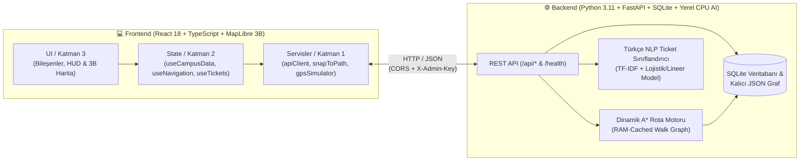

# 🧭 GTÜ-NAV: Gebze Teknik Üniversitesi Akıllı Kampüs Navigasyon ve Arıza Bildirim Sistemi

[](docker-compose.yml)
[](http://localhost:8000/docs)
[](http://localhost:3000)
[](http://localhost:3000)
[](backend/Dockerfile)
[](backend/tests/)
[](#-1-üründeki-yerel-yapay-zekâ-bileşeni-yerel-cpu-türkçe-nlp-triyaj)

> **Akıllı Kampüs & Konum Tabanlı Deneyim Sistemleri** | Gebze Teknik Üniversitesi Çayırova Kampüsü

---

### 🎥 Jüri Canlı Tanıtım ve Demo Videosu
[-red?style=for-the-badge&logo=youtube)](https://youtu.be/AQKpiyWUAOs)

> 📺 **YouTube Video Bağlantısı:** [https://youtu.be/AQKpiyWUAOs](https://youtu.be/AQKpiyWUAOs)  
> *(3B kampüs haritası, dinamik A\* yaya navigasyonu, yürüyüş simülatörü, yerel NLP arıza bildirimi ve Marmaray entegrasyonu akışını içerir).*

---

**GTÜ-NAV**, yaklaşık **1.400.000 m²** (360 hektar) büyüklüğündeki ormanlık ve çok binalı Gebze Teknik Üniversitesi kampüsünde; öğrencilerin, akademisyenlerin ve ziyaretçilerin yaya navigasyonu, derslik/akademisyen arama, Marmaray ring takibi ve anlık kampüs arıza bildirim süreçlerini tek bir hızlandırılmış 3B web arayüzünde birleştiren yeni nesil bir **Akıllı Kampüs Platformudur**.

---

## 🎯 Problem ve Çözüm Yaklaşımımız

| Kampüsteki Gerçek Problem | GTÜ-NAV Mühendislik Çözümü |
| :--- | :--- |
| **Standart Harita Uygulamalarının Kampüs İçi Yetersizliği:** Ticari harita servisleri kampüs içindeki patikaları, kilitli kapıları ve bina içi derslik/akademisyen bilgilerini bilmez. | **Kampüse Özel Yaya Grafı ve Dinamik A\* (A-Star) Rota Motoru:** Kampüs içi tüm yürüyüş yollarını, bina giriş kapılarını ve anlık kapalı yolları bilen özel topolojik graf motoru. |
| **GPS Sıçramaları (Ağaçlık & Bina Kanyonu Etkisi):** Ham mobil GPS verisi kampüs binaları ve sık ağaçlık alanlarda 5–15 metre saparak kullanıcıyı bina duvarlarının içinden yürüyormuş gibi gösterir. | **2B Kalman Filtresi + Vektörel `Snap-to-Path` Motoru:** Ham GPS gürültüsünü filtreleyip yaya konumunu en yakın fiziksel yürüyüş koridoruna dik izdüşümle kilitleyen kesintisiz konum sabitleme algoritması. |
| **Marmaray ve Ring Seferlerine Yetişme Belirsizliği:** Kampüsün büyüklüğü sebebiyle öğrencilerin durağa yürüme sürelerini ve treni yakalayıp yakalayamayacaklarını kestirmeleri güçtür. | **🚆 Canlı Marmaray Sayacı ve Ring Takibi:** Kullanıcının anlık konumuna göre Fatih Marmaray istasyonuna dinamik yürüme süresi hesaplayan ve trene yetişme durumunu canlı gösteren entegrasyon motoru. |
| **Kayıtsız ve Sınıflandırılmayan Kampüs Arızaları:** Kırık kaldırımlar, aydınlatma sorunları veya su kaçakları ilgili daire başkanlığına ulaşmadan kaybolur. | **🧠 Yerel Yapay Zekâ Destekli Yazılı Ticket & LiveOps Merkezi:** KVKK uyumlu (fotoğrafsız, yalnızca yapılandırılmış yazılı metin) arıza bildirimlerini **<5 ms** içinde ilgili birime ve aciliyet puanına göre sınıflandıran yerel CPU NLP modeli. |

---

## 🏗️ Sistem Mimarisi ve Klasör Yapısı

GTÜ-NAV, teknik şartnameye tam uyumlu olarak **tek komutla (`docker compose up --build`)** ayağa kalkan, dış bulut API anahtarı gerektirmeyen (Offline-Ready, %100 yerel CPU) iki katmanlı bir mimari üzerine inşa edilmiştir:



### 📂 Depo Dizin Yapısı

```text
GTÜ-NAV/
├── docker-compose.yml              # Tek komutla tam yığın (Full-Stack) orkestrasyon
├── .env.example                    # Örnek ortam değişkenleri şablonu
├── backend/                        # Python 3.11 + FastAPI Arka Uç Servisi (Port: 8000)
│   ├── Dockerfile                  # python:3.11-slim tabanlı üretim imajı
│   ├── requirements.txt            # FastAPI, uvicorn, scikit-learn, sqlalchemy, pytest
│   ├── app/
│   │   ├── main.py                 # REST API uç noktaları, /health kontrolü ve güvenlik
│   │   ├── models.py & schemas.py  # SQLAlchemy ORM modelleri ve Pydantic şemaları
│   │   ├── seed.py                 # Kampüs veritabanı tohumlayıcı ve JSON senkronizasyonu
│   │   ├── routing/
│   │   │   └── astar.py            # Bellek önbellekli Dinamik A* yaya rota motoru
│   │   ├── ai/
│   │   │   ├── dataset.py          # Kampüs odaklı Türkçe arıza eğitim veri seti
│   │   │   ├── train_model.py      # TF-IDF (Kelime + Karakter N-Gram) model eğitici
│   │   │   └── ticket_classifier.py# <5ms CPU çıkarım (Inference) motoru
│   │   └── data/
│   │       ├── gtu_buildings.json  # 3B bina poligonları, giriş kapıları ve derslikler
│   │       └── gtu_walk_graph.json # Topolojik yürüyüş yolları düğüm ve kenar ağı
│   └── tests/                      # Pytest birim ve entegrasyon test paketi (17/17 PASS)
└── frontend/                       # React 18 + TypeScript + Vite + Tailwind (Port: 3000)
    ├── Dockerfile                  # Node build + Nginx alpine üretim sunucusu
    ├── nginx.conf                  # SPA yönlendirmeleri ve statik dosya sunumu
    ├── package.json
    ├── src/
    │   ├── services/               # Katman 1: Saf iş mantığı (snapToPath, gpsSimulator, apiClient)
    │   ├── hooks/                  # Katman 2: Durum kancaları (useNavigation, useTickets, useCampusData)
    │   └── components/             # Katman 3: 3B Harita, HUD, AdminCommandCenter, Detay Çekmeceleri
    └── public/
```

---

## 🚀 Hızlı Kurulum ve Çalıştırma (Tek Komut)

Projeyi çalıştırmak için sisteminizde **Docker** ve **Docker Compose** kurulu olması yeterlidir. Dış API anahtarına (Google Maps, OpenAI vb.) ihtiyaç **duyulmaz**.

### 1. Docker ile Tek Komutta Başlatma (Şartname Standardı)

```bash
git clone https://github.com/MehmetBalci43/GTU-NAV.git
cd GTU-NAV
docker compose up --build
```

Konteynerler ayağa kalktığında tarayıcınızdan aşağıdaki adreslere erişebilirsiniz:

| Servis | Adres (URL) | Açıklama |
| :--- | :--- | :--- |
| **🌐 Web Uygulaması (Frontend)** | [http://localhost:3000](http://localhost:3000) | 3B Kampüs Haritası, Yaya Navigasyonu & Yönetici LiveOps Paneli |
| **📘 Swagger API Dokümantasyonu** | [http://localhost:8000/docs](http://localhost:8000/docs) | İnteraktif OpenAPI / REST uç nokta dokümantasyonu |
| **🩺 Sistem Sağlık Kontrolü** | [http://localhost:8000/health](http://localhost:8000/health) | Veritabanı, AI Modeli ve Graf Motoru canlılık durumu (`200 OK`) |

---

### 2. Yerel Geliştirme Ortamında (Docker Olmadan) Çalıştırma

**Arka Uç (Backend - Port 8000):**
```bash
python -m venv .venv
# Windows:
.\.venv\Scripts\activate
# Linux / macOS:
source .venv/bin/activate

pip install -r backend/requirements.txt
uvicorn app.main:app --app-dir backend --reload --port 8000
```

**Ön Yüz (Frontend - Port 3000):**
```bash
cd frontend
npm install
npm run dev
```

**Birim ve Entegrasyon Testlerinin Çalıştırılması:**
```bash
# Windows:
.\.venv\Scripts\pytest backend/tests/ -v
# Linux / macOS:
pytest backend/tests/ -v
```

---

## 🧠 Yapay Zekâ Kullanımı (Teknik Şartname Madde 3, 4 ve 5)

### 1. Üründeki Yerel Yapay Zekâ Bileşeni (Yerel CPU Türkçe NLP Triyaj)
Sistemde dış bulut API'lerine (OpenAI, Gemini, Claude vb.) bağımlı kalmadan, **tamamen Docker konteyneri içinde, yerel CPU üzerinde, çevrimdışı (offline) ve <5 milisaniye gecikmeyle** çalışan bir makine öğrenmesi modeli konumlandırılmıştır:

1. **Özellik Çıkarımı (Feature Extraction):** Metin hem kelime tabanlı (`1-2 ngram`) hem de Türkçe sondan eklemeli morfolojiye dayanıklı karakter tabanlı (`3-5 char_wb ngram`) **TF-IDF vektörleştiriciden** geçirilir.
2. **Birim Sınıflandırma (Department Classification):** Öğrencinin haritadan seçtiği yazılı bildirim anında ilgili üniversite birimine atanır:
   - *Yapı İşleri ve Teknik Daire Başkanlığı* (Asansör arızası, su kaçağı, kırık kaldırım, aydınlatma vb.)
   - *Bilgi İşlem Dairesi Başkanlığı* (Eduroam kopması, projeksiyon/akıllı tahta arızası vb.)
   - *İdari ve Mali İşler / Güvenlik Amirliği* (Güvenlik, bariyer, başıboş hayvan tehlikesi vb.)
   - *Sağlık, Kültür ve Spor Dairesi (SKS)* (Yemekhane, kantin, spor salonu, temizlik/hijyen vb.)
3. **Aciliyet Skoru Tahmini (`1` – `10` Arası):** Lojistik/Lineer regresyon katmanı ile güvenlik riskleri birleştirilerek bildirime 1-10 arası aciliyet puanı atanır ve yönetici LiveOps ekranında önceliklendirilir.
4. **KVKK Uyumlu Tasarım:** Sıfır fotoğraf ve sıfır kişisel veri toplanır; yalnızca yapılandırılmış metin ve harita koordinatı işlenir.

---

### 2. Geliştirme Sürecinde Yapay Zekâ Asistanı Kullanımı (Şartname Madde 5)
Projenin mimari tasarım, kodlama ve test aşamalarında yapay zekâ kodlama asistanlarından etkin ve akılcı bir şekilde yararlanılmıştır:

* **Kullanılan Araçlar:** Antigravity (Advanced Agentic AI) ve Claude/Gemini modelleri.
* **Hangi İşlerde Kullanıldı?**
  - Kampüs topolojik yaya grafının (`gtu_walk_graph.json`) düğüm/kenar veri yapısının ve hafıza önbellekli Dinamik A\* algoritmasının matematiksel tasarımında.
  - Vektörel dik izdüşüm (`Snap-to-Path`) ve 2B Kalman filtresinin formülasyonunda.
  - MapLibre GL 3B harita katmanları ve React hook yaşam döngüsü senkronizasyonunda.
  - Türkçe arıza bildirim veri setinin (`dataset.py`) ve TF-IDF pipeline mimarisinin oluşturulmasında.
* **Nasıl İstemlerle (Prompting) Kullanıldı?**
  - Doğrudan ham kod istemek yerine mimari sınırlar ve kısıtlar baştan tanımlandı: *"Harici hiçbir API kullanmadan, sadece yerel CPU üzerinde <5ms'de çalışacak, Türkçe eklemeli dil yapısına uygun hibrit n-gram TF-IDF sınıflandırıcısı tasarla."*
  - Rota hesaplama için: *"Kampüs içindeki paralel yolları ve çift kapılı binaları hesaba katan, kapalı yol durumunda RAM'deki grafı anında güncelleyen bir A\* algoritması yaz."*
* **Neyi Kendimiz Düzeltmek Zorunda Kaldık?**
  - **GPS Sıçraması ve Tolerans Ayarları:** Asistanın ilk önerdiği 5 metrelik snap toleransı, ormanlık alandaki gerçek GPS sapmalarında yetersiz kaldı; saha testleri doğrultusunda 25 metre bina içi tolerans ve 35 metre koridor kilitlenme eşiği elle kalibre edildi.
  - **Çift Giriş Kapısı & İç Mekan GPS Koordinatı:** Kullanıcı bina içindeyken haritada kullanıcının gerçek GPS noktasının korunması ve en yakın çıkış kapısına doğru rota çizilmesi mantığı özel olarak revize edildi.
  - **MapLibre Render Döngüsü:** React bileşenlerinin kamera hareketlerindeki gereksiz yeniden render (re-render) döngüleri tespit edilip `useMemo` ve referans tabanlı durum makineleriyle optimize edildi.

---

## 🧲 Yoldan Sapmayan Yaya Navigasyonu (`Snap-to-Path` + Dinamik A\*)

Kampüs içi yaya navigasyonunda en büyük sorun, ham GPS koordinatlarının binaların içine veya çimenlik alanlara sıçramasıdır. GTÜ-NAV bu sorunu üç aşamalı bir geometrik boru hattıyla çözer:

1. **2B Kalman Filtresi (`KalmanFilter2D`):** Cihazdan gelen ham `(lat, lng)` koordinatlarındaki ani sıçramaları sönümler.
2. **Vektörel Dik İzdüşüm (`Snap-to-Path`):** Kullanıcının konumu yürüme koridoruna dik izdüşümle mıknatıslanır:
   $$t = \text{clamp}\left(\frac{(\mathbf{P} - \mathbf{A}) \cdot (\mathbf{B} - \mathbf{A})}{\|\mathbf{B} - \mathbf{A}\|^2}, 0, 1\right), \quad \mathbf{P}_{\text{snap}} = \mathbf{A} + t(\mathbf{B} - \mathbf{A})$$
   Kullanıcı koridora **35 metreden** yakınsa imleç yola kilitlenir; **40 metreden** fazla uzaklaşırsa sistem otomatik olarak **Yeniden Rota Hesaplama (Auto-Reroute)** tetikler.
3. **Canlı Yol Kapatma (LiveOps) & Koridor Seviyesi Engelleme:**
   - Yönetici panelinden bir yol kapandığında (`PATCH /api/admin/edges/{edge_id}`), paralel refüj ve patikalar da dahil olmak üzere tüm koridor güvenliğe alınır ve anında yeni rota hesaplanır.

---

## 🔑 Jüri Hızlı Demo ve Test Bilgileri

Uygulamayı test ederken fiziksel olarak kampüste yürümenize gerek yoktur; tüm senaryolar arayüz üzerinden simüle edilebilir:

1. **🚶 Masaüstü Yürüyüş Simülatörü (GPS Simülasyonu):**
   - Harita üzerinden herhangi bir binayı seçip **"Buraya Rota Çiz"** butonuna tıklayın.
   - Alt navigasyon çubuğundaki **"▶️ Yürüyüşü Simüle Et"** butonuna bastığınızda, sanal yaya imleci hesaplanan A\* rotası boyunca adım adım yürür, kalan mesafe/süre ve yönlendirme komutları canlı güncellenir.
   - Harita üzerinde **"📍 Konumu Haritadan Seç"** butonuna basarak yaya konumunu binaların arasına sürükleyip `Snap-to-Path` mıknatıslanma etkisini canlı test edebilirsiniz.
2. **🛡️ Şifreli Yönetici (LiveOps) Komuta Merkezi Girişi:**
   - Sağ üstteki **"🛡️ Yönetici (LiveOps)"** sekmesine tıkladığınızda şifre penceresi açılır.
   - **Jüri Demo Yönetici Anahtarı:** `gtunav_admin_secret_2026` *(veya penceredeki **"🔑 Jüri Demo Anahtarını Doldur"** butonuna tek tıkla basabilirsiniz)*.
   - Yönetici panelinden:
     - Yapay zekâ tarafından aciliyet sırasına dizilmiş arıza bildirimlerini yönetebilirsiniz.
     - **Yol Ağı Kontrolü** sekmesinden kampüs yollarını tek tıkla kapatıp/açarak öğrenci rotasındaki anlık değişimi gözlemleyebilirsiniz.
3. **🚆 Marmaray & Kampüs Ring Takibi:**
   - Sağ üstteki **Marmaray Geri Sayım** rozetine tıklayarak GTÜ – Fatih Marmaray İstasyonu'na anlık yürüme sürenizi ve bir sonraki treni yakalayıp yakalayamayacağınızı (`Yetişirsiniz` / `Koşmalısınız`) görebilirsiniz.

---

## 👥 Proje Ekibi ve Geliştiriciler

* **Mehmet Balcı** — *Full-Stack Geliştirme, Rota Algoritmaları & Harita Entegrasyonu* ([GitHub](https://github.com/MehmetBalci43))

---

## 🔒 Telif Hakkı ve Lisans (Copyright)

**© 2026 GTÜ-NAV — Tüm Hakları Saklıdır (All Rights Reserved).**

Bu yazılım, kaynak kodları, 3B kampüs veri modelleri, algoritmik tasarımları ve dokümantasyonu Gebze Teknik Üniversitesi Akıllı Kampüs Projesi kapsamında geliştirilmiştir. Ekibin yazılı izni olmaksızın ticari amaçla kopyalanamaz, çoğaltılamaz veya dağıtılamaz.
